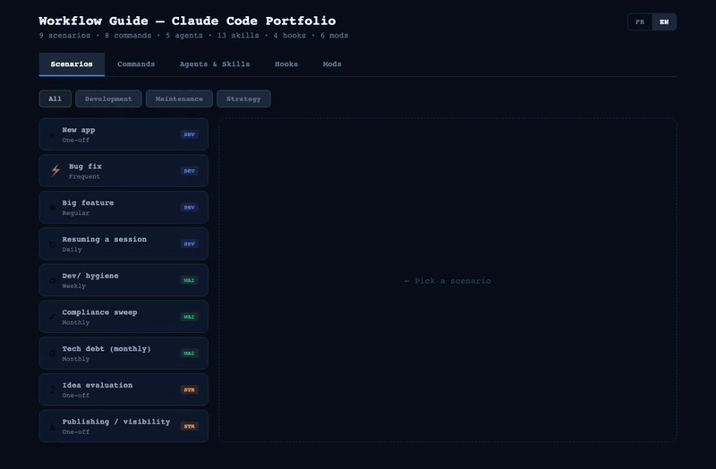

<!-- portfolio
name: "Claude Code Setup"
tagline_fr: "Mon workflow Claude Code, anonymisé et documenté."
tagline_en: "My Claude Code workflow, anonymized and documented."
about_en: "Claude Code hooks, agents and commands for running 10+ personal apps without babysitting every diff — MIT, 2 blocking hooks included."
facts_fr: "8 commandes, 5 agents, 10 skills, 4 hooks et 6 mods."
facts_en: "8 commands, 5 agents, 10 skills, 4 hooks and 6 mods."
-->

# Claude Code Setup

[](LICENSE) [](https://github.com/w2ur/claude-code-setup/commits/main) [](https://w2ur.github.io/claude-code-setup/workflow-guide.html)

My Claude Code workflow, anonymized and documented: the commands, agents, skills, hooks and mods I build my personal apps with.

**Status:** maintained · public. Kept in step with my live `~/.claude/` by [`/sync-setup`](commands/sync-setup.md).<br>
**Live:** [the workflow guide](https://w2ur.github.io/claude-code-setup/workflow-guide.html), interactive and bilingual (it opens in your browser's language, French or English, and remembers your choice).

[](https://w2ur.github.io/claude-code-setup/workflow-guide.html)

## Why

I'm not a developer: I've spent my career close to code without writing much of it — I understand architecture, I can debug a concept, but I don't read diffs. After months of trial, error, and way too many hours watching Claude Code attempt the same failing fix for the fifth time, I built a system: commands that orchestrate agents, agents that remember what they learned, skills that hold project conventions, hooks that nudge without blocking. It is not the configuration of a real developer, but it is the one that lets me run my applications with enough quality and consistency, and without falling into the usual traps of AI-written code.

The rest of the story is in [docs/story.md](docs/story.md).

## Scope

Everything here is about writing code. I run other Claude Code automation that isn't, and none of it is published, deliberately: those plugins, their skills, and the scripts that drive them are excluded at the source, and the sync script refuses to publish a file that carries them. If you spot a reference to something that isn't in this repo, that's why. What you see is the whole of the code-facing half, not a sample of a larger whole.

- **No application code.** Just configuration.
- **No personal data.** Public apps are mentioned by name (they're live on the internet anyway). Private apps, personal URLs, and paths are anonymized.
- **Not a universal solution.** This works for me. Parts of it will work for you. All of it, probably not — and that's fine.

## What's inside

You type a command; it dispatches agents; agents load skills; hooks guard the writes and the pushes; mods draw inside Claude Code itself. The diagram, the full descriptions and the reasons are in [docs/architecture.md](docs/architecture.md).

<details>
<summary><strong>Commands (8)</strong> — entry points that orchestrate everything</summary>

| Command | What it does | When to use it |
|---------|-------------|----------------|
| `/audit` | Parallel docs-checker + portfolio-audit | Before releases, compliance sweeps |
| `/new-app` | Full scaffold with portfolio compliance from day one, including a design direction | Starting a new project |
| `/ship-plan` | Plan review → fold findings → stop for approval → execute → `/code-review high` → stop before push | Taking a written plan to reviewed code |
| `/model-review` | Derives every model pin and headless job, sets the new model's effort, re-tests prompts and design scaffolding | When a new model release lands |
| `/design-audit` | Audits the rendered design of live sites: evidence capture first, then one critique per site | After a visual change, or a periodic design sweep |
| `/cleanup` | Disk hygiene sweep of `~/.claude` first, then stale plans, plugin audit, memory compaction | Weekly housekeeping |
| `/tech-debt` | Monthly triage → deep review → auto-fix | Monthly health check |
| `/sync-setup` | Sync this repo from live `~/.claude/` config (anonymize + audit) | After workflow changes |

</details>

<details>
<summary><strong>Agents (5)</strong> — the workers, each with a specific role and model</summary>

| Agent | Model | Memory | What it does | What it doesn't do |
|-------|-------|--------|--------------|--------------------|
| **implementer** | `sonnet` | yes | Executes tasks with "done when" criteria | Architecture decisions |
| **troubleshooter** | `inherit` | yes | L3 of the escalation cascade: structural diagnosis, produces plans | Write production code |
| **docs-checker** | `sonnet` | — | Audits + fixes README, CLAUDE.md, verifies declared URLs resolve | Compliance standards |
| **portfolio-audit** | `haiku` | — | Read-only compliance check (signature, secrets, tests) | Fix anything |
| **dummy-visitor** | `sonnet` | — | Bilingual FR/EN naive visitor — perception vs. intent review | Compare to competitors |

</details>

<details>
<summary><strong>Skills (10)</strong> — preloaded knowledge and on-demand guides</summary>

- **portfolio-conventions**: cross-project standards, preloaded into `troubleshooter`
- **scheduled-jobs**: why each scheduled job exists, and which plausible "fixes" are wrong
- **claude-md-hygiene**: how to cut a CLAUDE.md without losing a fact
- **python-uv**: why `uv` is the only Python manager, and where the enforcement lives
- **ci-and-branch-protection**: the zero-coverage hole in aggregate CI gates, and the solo-merge traps
- **testing-conventions**: regression-test format, property tests, measured blind spots of a green suite
- **memory-and-plans**: how the two memory systems resolve on disk
- **design-tells**: the defaults a model reaches for in UI work, and what to do instead
- **design-critique**: loaded before reviewing any rendered UI
- **design-direction**: loaded before designing a page with no `DESIGN.md` yet

</details>

<details>
<summary><strong>Hooks (4)</strong> — 2 advisory + 2 blocking</summary>

- **secret-scan**: blocks a write, edit or command containing API key patterns *(blocking)*
- **push-build-gate**: runs the build and the tests before `git push`, plus a Next.js payload gate *(blocking)*
- **auto-format**: Ruff on `.py`, rustfmt on `.rs`, when the repo configures them *(advisory)*
- **stale-readme-guard**: flags unpushed deploy/dep changes with no README update *(advisory)*

</details>

<details>
<summary><strong>Mods (6)</strong> — TypeScript hooks into Claude Code itself</summary>

- **panel** (`/panel`): the right panel; every other mod joins it as a tab
- **context-bar**: the context window as a grid of squares, one colour per category
- **usage-forecast**: each rate-limit window as a race, plus the fan-out guard
- **agent-fleet** (`/fleet`): subagents and Workflow runs as small ASCII personas
- **portrait** (`/portrait`): the owner portrait drawn as a bust filled with its own text
- **graphe** (`/graphe`): a writings graph drawn in ASCII

</details>

## Quick start

Requirements: `jq`, `uv` (with a managed Python), `git`, Node with `npm`, and `gh` for some helper scripts. Then, to copy the whole system:

```bash
git clone https://github.com/w2ur/claude-code-setup.git
mkdir -p ~/.claude/{commands,agents,skills,hooks,mods,scripts}
cp -R claude-code-setup/commands/. ~/.claude/commands/
cp -R claude-code-setup/agents/. ~/.claude/agents/
cp -R claude-code-setup/skills/. ~/.claude/skills/
cp -R claude-code-setup/hooks/. ~/.claude/hooks/
cp -R claude-code-setup/mods/. ~/.claude/mods/
cp -R claude-code-setup/claude-scripts/. ~/.claude/scripts/
if [ -f ~/.claude/CLAUDE.md ]; then cp ~/.claude/CLAUDE.md ~/.claude/CLAUDE.md.bak; fi
cp claude-code-setup/CLAUDE.md ~/.claude/CLAUDE.md
if [ ! -f ~/.claude/settings.json ]; then echo '{}' > ~/.claude/settings.json; fi
```

Copying is not enough: hooks and mods load only once they are registered in `~/.claude/settings.json`. [docs/install.md](docs/install.md) has the requirements in full, the settings merge, the mod list, the placeholders to replace, the cherry-pick and read-only options, and how to adapt the setup to fewer apps, a team, another stack or a monorepo.

## Maintenance

This repo stays in sync with my actual `~/.claude/` setup via `/sync-setup` — a command that runs a Python sync script to copy, anonymize, and audit for data leaks. After any workflow change (new agent, renamed command, new hook), I run `/sync-setup` and the repo updates itself. See [`scripts/`](scripts/) for details. The helper scripts the global `CLAUDE.md` calls under `~/.claude/scripts/` are published in [`claude-scripts/`](claude-scripts/), synced and anonymized the same way.

If something looks outdated, it probably means I changed my setup and haven't synced yet. Open an issue — it's a good nudge.

## Documentation

- [Architecture](docs/architecture.md): the diagram, every command, agent, skill, hook and mod in full, and the rules of the global `CLAUDE.md`
- [Key decisions](docs/decisions.md): what I chose, and the alternative I turned down
- [Install and adapt](docs/install.md): requirements, registration, cherry-picking, adapting
- [Philosophy](docs/philosophy.md) and [the story](docs/story.md): why it is built this way
- [FAQ](docs/faq.md)
- Elsewhere: [claude-code-best-practice](https://github.com/shanraisshan/claude-code-best-practice), the comprehensive community reference; [Anthropic's Claude Code docs](https://docs.anthropic.com/en/docs/claude-code); [William Revah on LinkedIn](https://www.linkedin.com/in/williamrevah), where I write about building apps with AI, cognitive biases, and whatever else I'm curious about

## Contributing

This is a personal setup, not a framework. I'm not accepting PRs that change the architecture or philosophy. But I welcome bug reports (something broken, inconsistent or unclear), questions (open an issue, I'll answer and improve the docs), and adaptations: if you built something interesting on top of this, I'd love to hear about it.

## Third-party skills I use

Three skills in my setup are not mine. I vendor them verbatim apart from one local change (noted below) and do not republish them here: `/sync-setup` skips them, so this repo ships none of their files. The author's repository is the source; read and install them there. All three are MIT-licensed, by [Emil Kowalski](https://github.com/emilkowalski).

| Skill | What it does | Source | Licence |
|---|---|---|---|
| `apple-design` | Apple's fluid-interface principles (springs, momentum, interruptible gestures) translated for the web | [emilkowalski/skills](https://github.com/emilkowalski/skills/tree/e8a175de22ae1e49370fc144c1f3bb9aeedf988d/skills/apple-design) | MIT |
| `review-animations` | Reviews animation code against a high craft bar; defaults to flagging | [emilkowalski/skills](https://github.com/emilkowalski/skills/tree/e8a175de22ae1e49370fc144c1f3bb9aeedf988d/skills/review-animations) | MIT |
| `break-ui` | Stress-tests UI with worst-case data and reports what breaks, with fixes | [emilkowalski/skills](https://github.com/emilkowalski/skills/tree/e8a175de22ae1e49370fc144c1f3bb9aeedf988d/skills/break-ui) | MIT |

Local change: I removed the canned greeting block from `apple-design`; the other two are verbatim.

## License

[MIT](LICENSE), by [William Revah](https://william.revah.paris) — copy, adapt, share. Attribution appreciated but not required.
