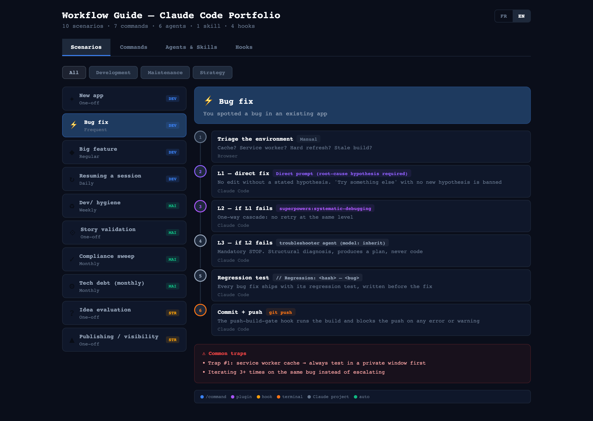
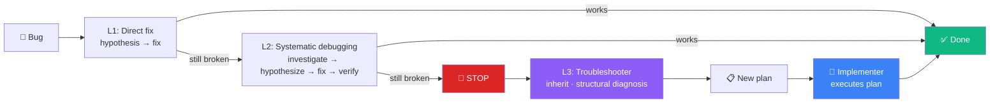

<div align="center">

# claude-code-setup

[](LICENSE)
[](https://docs.anthropic.com/en/docs/claude-code)
[](#the-story)

> If [claude-code-best-practice](https://github.com/shanraisshan/claude-code-best-practice) is the encyclopedia, this is the field guide.

An opinionated, production-tested Claude Code configuration for solo developers managing multiple apps.<br>
Not a tutorial — a real setup that runs daily across 10+ personal projects,<br>
shared so you can steal the parts that work for you.

</div>

---

**[The Story](#the-story)** · **[What's Inside](#whats-inside)** · **[Key Decisions](#key-decisions)** · **[Quick Start](#quick-start)** · **[Adapting](#adapting-to-your-setup)** · **[Philosophy](docs/philosophy.md)**

---

## The Story

I'm not a developer. I've spent 20 years close to code without writing much of it — I understand architecture, I can debug a concept, but I don't read diffs. I haven't looked at a line of code in my projects for months.

What I do is build things. I maintain a portfolio of 10+ personal apps — budget trackers, reading lists, encyclopedias, games, tools for my family. Different stacks, different audiences, different deployment targets. One development environment: Claude Code.

After months of trial, error, and way too many hours watching Claude Code attempt the same failing fix for the fifth time, I built a system. Commands that orchestrate agents. Agents that remember what they learned. Skills that preload project conventions. Hooks that nudge without blocking.

This repo is that system, anonymized and documented. It's opinionated because opinions are what's missing from most "best practices" repos — I'll tell you what I chose *and why I chose it over the alternative*.

As Boris Cherny, who created Claude Code, [put it](https://x.com/bcherny/status/2021699851499798911): "Every engineer uses their tools differently." This is my way.

### What this repo is *not*

Everything here is about writing code. I run other Claude Code automation that isn't, and none of it is published, deliberately: those plugins, their skills, and the scripts that drive them are excluded at the source, and the sync script refuses to publish a file that carries them. If you spot a reference to something that isn't in this repo, that's why. What you see is the whole of the code-facing half, not a sample of a larger whole.

## What's Inside

```
┌───────────────────────────────────────────────────────────┐
│                    You type a command                     │
│      /audit  /cleanup  /new-app  /tech-debt  /sync-setup  │
│        /model-review  /ship-plan  /design-audit           │
└─────────────────────────────┬─────────────────────────────┘
                              │
                              ▼
┌───────────────────────────────────────────────────────────┐
│                          Agents                           │
│                                                           │
│  implementer ───── sonnet                                 │
│  troubleshooter ── inherit (never weaker than the caller) │
│  docs-checker ─── sonnet (audits README, CLAUDE.md)       │
│  portfolio-audit  haiku (compliance checks)               │
│  dummy-visitor ── sonnet (bilingual naive-visitor review) │
│                                                           │
│  ┌────────────┐  ┌──────────────────────────────────┐     │
│  │   Memory   │  │  Skills                          │     │
│  │ per agent  │  │  portfolio-conventions (preload) │     │
│  │ per project│  │  ── the rest load on demand ──   │     │
│  └────────────┘  │  scheduled-jobs                  │     │
│                  │  claude-md-hygiene               │     │
│                  │  python-uv                       │     │
│                  │  ci-and-branch-protection        │     │
│                  │  testing-conventions             │     │
│                  │  memory-and-plans                │     │
│                  │  design-tells                    │     │
│                  │  design-critique                 │     │
│                  │  design-direction                │     │
│                  └──────────────────────────────────┘     │
└─────────────────────────────┬─────────────────────────────┘
                              │
                              ▼
┌───────────────────────────────────────────────────────────┐
│                          Hooks                            │
│                                                           │
│  stale-readme-guard  "Docs still current?"     (advisory) │
│  auto-format ─────── "Format the file"         (advisory) │
│  secret-scan ─────── "API key in source?"      (blocking) │
│  push-build-gate ─── "Build + tests green?"    (blocking) │
└───────────────────────────────────────────────────────────┘

┌───────────────────────────────────────────────────────────┐
│               Mods (inside Claude Code itself)            │
│                                                           │
│  context-bar ──── /context-bar  context window, by kind   │
│  usage-forecast ─ /usage-bar    5h / 7d burn and reset    │
│  fanout-guard ─── asks before a fan-out near the limit    │
│  agent-fleet ──── /fleet        subagents and workflows   │
└───────────────────────────────────────────────────────────┘
```

> [!TIP]
> For a visual, interactive version of this architecture, [open the workflow guide](https://w2ur.github.io/claude-code-setup/workflow-guide.html) — it's bilingual and opens in your browser's language, French or English (FR/EN toggle in the header, and it remembers your choice).

[](https://w2ur.github.io/claude-code-setup/workflow-guide.html)

<sub>The guide, on the scenario I run most: triage the environment first, then a one-way L1 → L2 → L3 escalation, then a regression test written before the fix.</sub>

<details>
<summary><strong>Commands (8)</strong> — entry points that orchestrate everything</summary>

<br>

| Command | What it does | When to use it |
|---------|-------------|----------------|
| `/audit` | Parallel docs-checker + portfolio-audit | Before releases, compliance sweeps |
| `/new-app` | Full scaffold with portfolio compliance from day one, including a design direction | Starting a new project |
| `/ship-plan` | Plan review → fold findings → stop for approval → execute → `/code-review high` → stop before push | Taking a written plan to reviewed code |
| `/model-review` | Derives every model pin and headless job, sets the new model's effort, re-tests prompts and design scaffolding | When a new model release lands |
| `/design-audit` | Audits the rendered design of live sites: evidence capture first, then one critique per site | After a visual change, or a periodic design sweep |
| `/cleanup` | Disk hygiene sweep of `~/.claude` first, then stale plans, plugin audit, memory compaction | Weekly housekeeping |
| `/tech-debt` | Monthly triage → deep review → auto-fix | Monthly health check |
| `/sync-setup` | Sync this repo from live `~/.claude/` config (anonymize + audit) | After workflow changes |

</details>

<details>
<summary><strong>Agents (5)</strong> — the workers, each with a specific role and model</summary>

<br>

| Agent | Model | Memory | What it does | What it doesn't do |
|-------|-------|--------|--------------|--------------------|
| **implementer** |  | ✅ | Executes tasks with "done when" criteria | Architecture decisions |
| **troubleshooter** | `inherit` (session model — never weaker than the caller) | ✅ | L3 of the escalation cascade: diagnoses structural problems after a direct fix and systematic debugging have both failed, produces plans | Write production code |
| **docs-checker** |  | — | Audits + fixes README, CLAUDE.md, verifies declared URLs actually resolve | Compliance standards |
| **portfolio-audit** |  | — | Read-only compliance check (signature, secrets, tests) | Fix anything |
| **dummy-visitor** |  | — | Bilingual FR/EN naive visitor — two-phase perception vs. intent review | Compare to competitors |

The model selection matters. I don't pay opus prices for a compliance check that haiku handles perfectly. Heavier, cross-file work doesn't live on a fixed agent — it escalates by dispatch, at the model tier the task calls for.

</details>

<details>
<summary><strong>Skills (10)</strong> — preloaded knowledge and user-invocable utilities</summary>

<br>

- **portfolio-conventions**: condensed version of cross-project standards (naming, signature, dark mode, docs, the three-layer inventory that replaced the per-repo manifest, quality gates, display order). Loaded into `troubleshooter`.
- **scheduled-jobs**: why each scheduled job exists, at the hour it is scheduled, and which plausible "fixes" are wrong — the login-keychain trap outside a GUI session, per-job PATH, the 0/1/2 exit convention. Current state is derived by `claude-scripts/jobs-inventory.sh`, never written into the skill — the prose version of that inventory drifted repeatedly before it was replaced by a script.
- **claude-md-hygiene**: how to cut a CLAUDE.md without losing a fact — the four-bucket taxonomy (guard / instruction / domain knowledge / archaeology), the trigger-line shape without which an extracted skill never loads, the `.gitignore` prerequisite, and the line-coverage check that must be made to fail once before its silence counts as evidence.
- **python-uv**: why `uv` is the only Python manager here, where the enforcement actually lives (a config file, emphatically not a shell rc — a scheduled job never sources one), and which plausible "fixes" are wrong.
- **ci-and-branch-protection**: the zero-coverage hole in an aggregate CI job (`jq 'all(.[]; …)'` over an empty set returns `true`, so the obvious gate reports success on nothing), why branch protection is advisory on a private repo on the free tier, and the three traps that permanently deadlock a solo merge.
- **testing-conventions**: the regression-test comment format, property-test setup, the financial-math tolerance that was measured too tight at `1e-10`, and the measured blind spots of a green suite.
- **memory-and-plans**: how the two memory systems resolve on disk, why per-agent stores are project-scoped and must never be consolidated upward or committed.
- **design-tells**: the named trap list for UI work in a project with no stated direction — the patterns a model reaches for by default (cream grounds, italic accent words, numbered section labels, pill buttons…), each with what to do instead. A project's own design section overrides it.
- **design-critique**: loaded before reviewing any rendered UI — a live site, a local build, or a page just changed — and before claiming a visual change is done.
- **design-direction**: loaded before designing or redesigning a site or page when no `DESIGN.md` exists yet; it writes the direction down before any code.

The first two are the survivors of an earlier, larger set; the rest arrived the other way round. Everything after `scheduled-jobs` was **extracted from the global CLAUDE.md**, which is billed into every session under it and had grown past the point where that was worth paying. The rule that decides the split: a **guard** — anything that stops a wrong action, including "this looks like an obvious improvement but was measured to be wrong" — stays in CLAUDE.md; the **measurement behind it**, the falsifying control and the retraction story move into a skill. `claude-scripts/claude-md-weight.sh` measures the result and owns the threshold, so no number here can drift.

Each extracted skill is reached from CLAUDE.md by a line naming the skill *and* the situation that should trigger it. A bare "see the X skill" does not fire — nothing loads it.

Why skills instead of just writing longer agent prompts? Because skills are reusable across agents, versionable independently, and don't bloat agents that don't need them.

</details>

<details>
<summary><strong>Hooks (4)</strong> — 2 advisory + 2 blocking</summary>

<br>

- **secret-scan** (PreToolUse → Write|Edit|NotebookEdit|Bash): blocks a write, an edit, a notebook edit or a shell command containing API key patterns (`sk-`, `AKIA`, `ghp_`, etc.), excludes `.env.example` *(blocking)*. It needs `jq` and refuses the call, loudly, when `jq` is missing
- **push-build-gate** (PreToolUse → Bash `git push`): runs the build **and then the test suite** before the push goes out, and blocks on a build failure, a compiler warning, or a red suite. A suite that never finishes is bounded and *non*-blocking — fail closed on the guard's verdict, open on the guard's own malfunction. Skip the test stage with `TEST_GATE_SKIP=1 git push`. Its dispatch logic has its own harness, `hooks/push-build-gate/test_hook.sh`. A third tier, `payload_gate.py`, reads the Next.js build's own route table: it **blocks** a render-mode flip (a route that used to be prerendered is now dynamic) and **warns** on payload growth against a per-repo baseline — 3x versus either the last push or the first reading, plus a 1 MiB backstop per prerendered file. Accept and re-record with `PAYLOAD_GATE_ACCEPT=1 git push`. It no-ops on anything that isn't a Next.js build *(blocking)*
- **auto-format** (PostToolUse → Write|Edit): runs Ruff on an edited `.py` file when the repo configures ruff, rustfmt on an edited `.rs` file inside a Cargo project — silent if not *(advisory)*
- **stale-readme-guard** (PreToolUse → Bash `git push`): checks unpushed commits for deploy/dep changes without a README.md update *(advisory)*

Half the hooks are advisory — I need Claude Code to exercise judgment, not pass checklists. There are two blocking exceptions now: secret scanning, because accidentally committing an API key is irreversible, and the push build gate, because shipping a broken build is a different kind of irreversible — it's live the moment it deploys. On a machine without a uv-managed Python the build gate fails open, loudly; see [`hooks/README.md`](hooks/README.md#requirements).

</details>

<details>
<summary><strong>Mods (4)</strong> — TypeScript hooks into Claude Code itself</summary>

<br>

A mod is a plugin of function hooks: a small TypeScript module that hooks into Claude Code itself — it can draw UI above the prompt, register a slash command, or hold a tool call. Each one lives in `mods/<name>/` and loads through `CLAUDE_CODE_PLUGIN_DIRS` in `~/.claude/settings.json`'s `env`, read straight from disk and reloaded on every edit (a marketplace install is a copy that needs reinstalling after each change).

- **context-bar** (`/context-bar`): the context window as a stacked bar above the prompt, one colour per `/context` category, with a token legend
- **usage-forecast** (`/usage-bar`): one line per rate-limit window — gauge, reset countdown, burn rate, and the time it fills if that comes before the reset; toasts at 80% and 95%
- **fanout-guard** (no command): past 85% of the 5-hour window or 90% of the 7-day one, asks before any Workflow and before the second Agent of a turn; a held or unanswered question refuses the call
- **agent-fleet** (`/fleet`): follows subagents and Workflow runs — a band above the prompt while a run is live, and a pane with one row per agent (model tier, effort, current tool, tokens, elapsed) plus the workflow's phases and Done / Failed / Denied / Lost sections. Known limits are listed at the top of `hooks/fleet.ts`

Each mod carries its own tests (`claude plugin test mods/<name>`).

</details>

### The Global CLAUDE.md

The `CLAUDE.md` at the root is the backbone — ~120 lines of rules that apply to every project. The most important ones:

> [!IMPORTANT]
> **The 3-level escalation cascade.** Each level forces a different approach. No retrying the same level twice. Every fix attempt requires a stated root cause hypothesis — no "let me try a different approach" without a new theory.



> [!WARNING]
> **Bug triage before code.** When I report a bug, Claude Code must rule out environment issues first — stale cache, service worker, old build. The most common "bugs" in my portfolio weren't bugs at all.

> [!NOTE]
> **Docs in the same commit as code.** There's no per-repo manifest file — docs are `README.md` (including its YAML frontmatter: `name`/`tagline_fr`/`tagline_en`/`facts_fr`/`facts_en`) and `CLAUDE.md`, and both ship with the feature, not as an afterthought. If the commit changes behavior, it changes documentation.

**The generalization check**, as it stands in the global `CLAUDE.md`:

> Before implementing a specific request, consider whether it's a special case of a pattern already in the portfolio. If the general solution is roughly the same effort, implement the general version with the specific case as the default. Skip when the general version materially increases complexity or when there's only one known use case. This is a judgment call, not a mandatory abstraction.

**Quality**, as it stands in the global `CLAUDE.md`:

<details>
<summary><strong>Quality section</strong></summary>

> - Zero build warnings. Exceptions → documented in the project CLAUDE.md with justification.
> - Conventional Commits. One logical change per commit.
> - **Tests are systematic**: unit for all logic, a regression test alongside every bug fix, property tests for pure transforms. **Load the `testing-conventions` skill** before writing tests, adding a regression test, or setting up property tests — it holds the comment format, the library choices and the financial-math arbitrary settings that were tuned by measurement.
> - After plan-driven sub-agent work, re-check every plan requirement against the code before reporting done (skip for direct single-file fixes). Service worker cache is the #1 false positive for "my change isn't showing" — rule it out before deeper debugging.
> - **A check that has never produced the opposite answer is not evidence.** Before trusting silence, a zero count, a "no match" or a green suite — and especially before writing it down as a finding — make the probe fail once. Grep for something you know is in that same artifact; fire the hook's real trigger and watch it warn; confirm a liveness marker is present in the local build *and* absent from the old one; check a known-good sibling URL resolves. **If you cannot make the check fail, it cannot pass.**
> - **Before writing or changing a CI gate, adding a pr-gate caller, or setting or checking branch protection, load the `ci-and-branch-protection` skill.** Two rules that must not be violated without reading it: **in CI, a check that did not run must never look like a check that passed** — an aggregate gate must assert a **named list of expected checks computed up front** and refuse an empty list, because `jq 'all(.[]; …)'` over an empty set returns `true`; and **branch protection needs a public repo on this account**, so every gate on a private repo is advisory — never write docs claiming enforcement, and do not fix it by upgrading to Pro.
> - **When a subagent reports a surprising finding, verify the reason, not just the conclusion.** A right conclusion resting on a false reason is what becomes doc drift or a wrong design decision — the conclusion gets accepted, and the reason gets written down.
> - **Budget multiple review rounds after any money-path fix.** The first pass on a pricing or ledger change reliably surfaces a second defect in the same neighbourhood — measured repeatedly, never once fewer than three rounds. Treat one clean round as the start of the review, not the end of it. Log the round count and model id of each money-path review in auto-memory; re-derive the number from that log.
> - **Never trust an empty review without checking the finders ran.** Zero findings and zero coverage are the same output — confirm the agents produced work before reading silence as a result. Same family as the falsifiable-control rule above.
> - **A test can pin a defect.** When a check disagrees with what you expect, read the test's *intent* before assuming the code is wrong — or right.
> - Before merging any nontrivial diff: run `/code-review` at **high** effort. Sub-agent-produced diffs are always reviewed before merge; when the change has a UI surface, **load the `design-critique` skill** and review the rendered page with it, reading the console too.
> - **`ultra` is not the default, and "multi-file" is not the trigger.** A prompt that is always declined is worse than no prompt: it trains both of us to skip the question, so the one time it matters gets waived on reflex too. Reserve `ultra` for a diff that touches a **money path** (pricing, ledger, fills, billing), **auth or secrets**, a **data migration**, or a **public API contract** — or when a normal review has already found a real defect and you want the surrounding neighbourhood swept. Otherwise `high` is the ceiling. Do not offer `ultra` merely because a change spans files.

</details>

## Key Decisions

These aren't arbitrary choices. Each one came from a specific failure. Read [the full story](docs/philosophy.md) for the context behind each decision.

| Decision | Alternative I considered | Why I went this way |
|----------|------------------------|-------------------|
| 3-level escalation cascade | Binary "2 fails → architect" | The old binary rule skipped a crucial step: structured debugging. Level 2 (systematic debugging skill) catches tricky-but-not-architectural bugs without invoking opus. |
| Troubleshooter never codes | One agent diagnoses and implements | When the same agent diagnoses and codes, it's biased toward solutions it can implement quickly rather than the right solution. |
| Advisory hooks + 2 blockers | All advisory or all blocking | Most hooks should nudge, not gate. The exceptions: secret scanning (an irreversible leak) and the push build gate (an irreversible bad deploy) both block. |
| Property-based tests for invariants | Unit tests only | Unit tests verify examples. Property tests verify *laws* — "transfers preserve totals" catches edge cases no human would write. |
| Model selection per task | Always use the best model | Haiku is perfect for audits. Sonnet handles 80% of implementation. Opus is for architecture and complex cross-file work. Matching model to task is a quality decision, not just a cost one. |
| Agent memory over lesson files | Flat markdown files per project | Files had no structure, no auto-injection, no compaction. Agent memory is read at startup, written automatically after corrections, and split when it grows too large. |
| Skills as preloaded context | Dynamic tool calls | Skills need to be available before the agent starts thinking. Dynamic loading means the agent might not know what it needs to know when making its first decision. |
| Derived inventory + README frontmatter + editorial file (no hand-typed manifest) | One manifest per repo (`.portfolio.yml`) | A hand-typed manifest went stale the moment you renamed an app — 26 files × ~18 fields nothing but the tooling policing them ever read. The inventory is built by observing GitHub, stack, and live-URL health at build time, so nothing hand-typed can drift. |

## Quick Start

> [!NOTE]
> The setup is fully modular — you can copy everything, cherry-pick individual pieces, or just read and adapt the patterns to your own system.

### Option A: Copy the whole system

```bash
git clone https://github.com/w2ur/claude-code-setup.git
mkdir -p ~/.claude/{commands,agents,skills,hooks,mods,scripts}
cp -R claude-code-setup/commands/. ~/.claude/commands/
cp -R claude-code-setup/agents/. ~/.claude/agents/
cp -R claude-code-setup/skills/. ~/.claude/skills/
cp -R claude-code-setup/hooks/. ~/.claude/hooks/
cp -R claude-code-setup/mods/. ~/.claude/mods/
cp -R claude-code-setup/claude-scripts/. ~/.claude/scripts/
if [ -f ~/.claude/CLAUDE.md ]; then cp ~/.claude/CLAUDE.md ~/.claude/CLAUDE.md.bak; fi
cp claude-code-setup/CLAUDE.md ~/.claude/CLAUDE.md
if [ ! -f ~/.claude/settings.json ]; then echo '{}' > ~/.claude/settings.json; fi
```

The helper scripts land in `~/.claude/scripts/` (published here as [`claude-scripts/`](claude-scripts/)); the commands and the global `CLAUDE.md` call them there. An existing `~/.claude/CLAUDE.md` is saved as `CLAUDE.md.bak` before it is overwritten, and an empty `settings.json` is created when you have none, so the merge below has a file to read.

Copying the scripts is not enough — hooks don't run until they're registered in `~/.claude/settings.json`. Merge `hooks/settings.hooks.json` into your own settings file (`jq -s '.[0] * .[1]' ~/.claude/settings.json claude-code-setup/hooks/settings.hooks.json > /tmp/settings.merged.json && mv /tmp/settings.merged.json ~/.claude/settings.json` if you don't already have a `hooks` key — see [`hooks/README.md`](hooks/README.md) for the manual-merge path if you do, plus how to verify a hook actually fired).

Mods are the same: copying `mods/` loads nothing. List each mod folder in `CLAUDE_CODE_PLUGIN_DIRS`, colon-separated, in the `env` block of `~/.claude/settings.json` (for example `"CLAUDE_CODE_PLUGIN_DIRS": "~/.claude/mods/context-bar:~/.claude/mods/usage-forecast:~/.claude/mods/fanout-guard:~/.claude/mods/agent-fleet"`), then start a new session.

Then edit `CLAUDE.md` and the agent files to replace `w2ur`, `{portfolio-site}`, and other placeholders with your own values.

### Option B: Cherry-pick what you need

The setup is modular. Want just the escalation system? Copy the global `CLAUDE.md`'s bug-handling cascade, the `implementer` agent, and the `troubleshooter` agent. Want just the maintenance workflow? Copy `/cleanup` and `/tech-debt`. Each piece works independently — the full system is better, but partial adoption works fine.

### Option C: Read and adapt

Browse the files, understand the patterns, and build your own version. The [philosophy doc](docs/philosophy.md) explains the "why" behind each choice — that's often more valuable than the "what."

## Adapting to Your Setup

<details>
<summary>This system was built for a very specific situation — here's how to adapt it to yours</summary>

<br>

**If you have 1-3 apps:** You don't need half of this. Drop `portfolio-audit` — it exists because I have 10+ repos to keep in sync. Keep the `implementer` and `troubleshooter` agents, the escalation cascade in the global `CLAUDE.md`, and the two blocking hooks. That alone is a massive upgrade over bare Claude Code.

**If you work in a team:** The escalation rules still apply — they're about AI behavior, not team size. The `implementer`/`troubleshooter` split actually maps well to teams where juniors implement and seniors review. The memory system needs thought, though — per-developer or shared? I haven't solved that one.

**If you have a different stack:** My skills are specific to my projects. Throw them out and write your own. The architecture (commands → agents → skills + hooks) doesn't care what language you write in.

**If you use a monorepo:** The `portfolio-audit` agent and `/tech-debt` assume separate repos. You'd need monorepo-aware versions. Everything else works as-is.

</details>

## What This Repo Does NOT Include

> [!CAUTION]
> - **Application code.** Zero lines of app code. Just configuration.
> - **Personal data.** Public apps are mentioned by name (they're live on the internet anyway). Private apps, personal URLs, and paths are anonymized.
> - **A universal solution.** This works for me. Parts of it will work for you. All of it, probably not — and that's fine.

## Maintenance

This repo stays in sync with my actual `~/.claude/` setup via `/sync-setup` — a command that runs a Python sync script to copy, anonymize, and audit for data leaks. After any workflow change (new agent, renamed command, new hook), I run `/sync-setup` and the repo updates itself. See [`scripts/`](scripts/) for details.

The global `CLAUDE.md` also references helper scripts under `~/.claude/scripts/` — they're published in [`claude-scripts/`](claude-scripts/), synced and anonymized the same way as everything else.

If something looks outdated, it probably means I changed my setup and haven't synced yet. Open an issue — it's a good nudge.

## Contributing

This is a personal setup, not a framework. I'm not accepting PRs that change the architecture or philosophy. But I welcome:

- **Bug reports:** if something is broken, inconsistent, or unclear
- **Questions:** open an issue, I'll answer and improve the docs
- **Adaptations:** if you built something interesting on top of this, I'd love to hear about it

## Third-party skills I use

Three skills in my setup are not mine. I vendor them verbatim apart from one local change (noted below) and do not republish them here: `/sync-setup` skips them, so this repo ships none of their files. The author's repository is the source; read and install them there. All three are MIT-licensed, by [Emil Kowalski](https://github.com/emilkowalski).

| Skill | What it does | Source | Licence |
|---|---|---|---|
| `apple-design` | Apple's fluid-interface principles (springs, momentum, interruptible gestures) translated for the web | [emilkowalski/skills](https://github.com/emilkowalski/skills/tree/e8a175de22ae1e49370fc144c1f3bb9aeedf988d/skills/apple-design) | MIT |
| `review-animations` | Reviews animation code against a high craft bar; defaults to flagging | [emilkowalski/skills](https://github.com/emilkowalski/skills/tree/e8a175de22ae1e49370fc144c1f3bb9aeedf988d/skills/review-animations) | MIT |
| `break-ui` | Stress-tests UI with worst-case data and reports what breaks, with fixes | [emilkowalski/skills](https://github.com/emilkowalski/skills/tree/e8a175de22ae1e49370fc144c1f3bb9aeedf988d/skills/break-ui) | MIT |

Local change: I removed the canned greeting block from `apple-design`; the other two are verbatim.

## Related

- [claude-code-best-practice](https://github.com/shanraisshan/claude-code-best-practice) — the comprehensive reference (encyclopedic, community-maintained)
- [Anthropic's Claude Code docs](https://docs.anthropic.com/en/docs/claude-code) — official documentation
- [William Revah on LinkedIn](https://www.linkedin.com/in/williamrevah) — where I write about building apps with AI, cognitive biases, and whatever else I'm curious about

## License

[MIT](LICENSE) — copy, adapt, share. Attribution appreciated but not required.

---

<div align="center">

*Built by [William](https://william.revah.paris) — someone who doesn't read code but ships 10+ apps anyway.*<br>
*Read [the philosophy](docs/philosophy.md) for the full story.*

</div>
