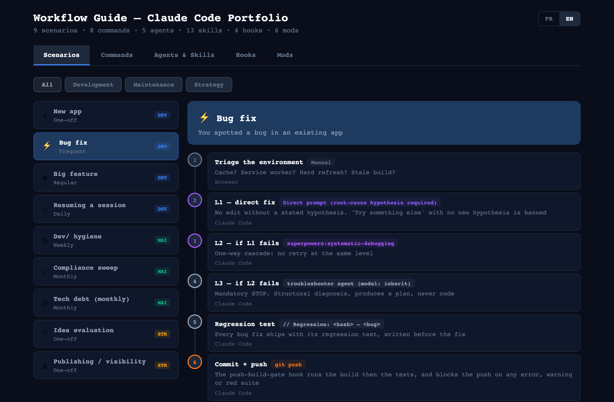
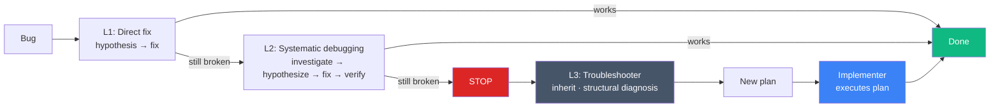

# Architecture

[Back to the README](../README.md)

How the pieces fit together, and why each one is shaped the way it is. The README's [What's inside](../README.md#whats-inside) is the short inventory that `/sync-setup` keeps in step with the live config; this page holds the longer descriptions and the reasons.

```
┌───────────────────────────────────────────────────────────┐
│                    You type a command                     │
│      /audit  /cleanup  /new-app  /tech-debt  /sync-setup  │
│        /model-review  /ship-plan  /design-audit           │
└─────────────────────────────┬─────────────────────────────┘
                              │
                              ▼
┌───────────────────────────────────────────────────────────┐
│                          Agents                           │
│                                                           │
│  implementer ───── sonnet                                 │
│  troubleshooter ── inherit (never weaker than the caller) │
│  docs-checker ─── sonnet (audits README, CLAUDE.md)       │
│  portfolio-audit  haiku (compliance checks)               │
│  dummy-visitor ── sonnet (bilingual naive-visitor review) │
│                                                           │
│  ┌────────────┐  ┌──────────────────────────────────┐     │
│  │   Memory   │  │  Skills                          │     │
│  │ per agent  │  │  portfolio-conventions (preload) │     │
│  │ per project│  │  testing-conventions   (preload) │     │
│  └────────────┘  │  python-uv             (preload) │     │
│                  │  claude-md-hygiene     (preload) │     │
│                  │  ── the rest load on demand ──   │     │
│                  │  scheduled-jobs                  │     │
│                  │  ci-and-branch-protection        │     │
│                  │  memory-and-plans                │     │
│                  │  design-tells                    │     │
│                  │  design-critique                 │     │
│                  │  design-direction                │     │
│                  └──────────────────────────────────┘     │
└─────────────────────────────┬─────────────────────────────┘
                              │
                              ▼
┌───────────────────────────────────────────────────────────┐
│                          Hooks                            │
│                                                           │
│  stale-readme-guard  "Docs still current?"     (advisory) │
│  auto-format ─────── "Format the file"         (advisory) │
│  secret-scan ─────── "API key in source?"      (blocking) │
│  push-build-gate ─── "Build + tests green?"    (blocking) │
└───────────────────────────────────────────────────────────┘

┌───────────────────────────────────────────────────────────┐
│               Mods (inside Claude Code itself)            │
│                                                           │
│  panel ────────── /panel     the right panel, one tab each│
│  context-bar ──── context window as a grid of squares     │
│  usage-forecast ─ 5h / 7d as a race; fan-out guard        │
│  agent-fleet ──── /fleet     subagents as ASCII personas  │
│  portrait ─────── /portrait  the owner portrait as a bust │
│  graphe ───────── /graphe    a writings graph in ASCII    │
└───────────────────────────────────────────────────────────┘
```

"Preload" means the skill is named in an agent's `skills:` frontmatter: `portfolio-conventions` in `troubleshooter`, `testing-conventions` and `python-uv` in `implementer`, `claude-md-hygiene` in `docs-checker`. Every other skill is reached from the global `CLAUDE.md` by a trigger line and loads only when that situation arises.



<sub>The [workflow guide](../README.md#claude-code-setup), on the scenario I run most: triage the environment first, then a one-way L1 → L2 → L3 escalation, then a regression test written before the fix.</sub>

## Agents

The model selection matters. I don't pay opus prices for a compliance check that haiku handles perfectly. Heavier, cross-file work doesn't live on a fixed agent — it escalates by dispatch, at the model tier the task calls for.

The `troubleshooter` is L3 of the escalation cascade: it diagnoses structural problems after a direct fix and systematic debugging have both failed, and produces plans. It runs on `inherit`, the session model, so it is never weaker than the caller. The `docs-checker` also verifies that declared URLs actually resolve. The `dummy-visitor` runs a two-phase review, perception versus intent, in French and English.

## Skills

- **portfolio-conventions**: condensed version of cross-project standards (naming, signature, dark mode, docs, the three-layer inventory that replaced the per-repo manifest, quality gates, display order). Loaded into `troubleshooter`.
- **scheduled-jobs**: why each scheduled job exists, at the hour it is scheduled, and which plausible "fixes" are wrong — the login-keychain trap outside a GUI session, per-job PATH, the 0/1/2 exit convention. Current state is derived by `claude-scripts/jobs-inventory.sh`, never written into the skill — the prose version of that inventory drifted repeatedly before it was replaced by a script.
- **claude-md-hygiene**: how to cut a CLAUDE.md without losing a fact — the four-bucket taxonomy (guard / instruction / domain knowledge / archaeology), the trigger-line shape without which an extracted skill never loads, the `.gitignore` prerequisite, and the line-coverage check that must be made to fail once before its silence counts as evidence. Loaded into `docs-checker`.
- **python-uv**: why `uv` is the only Python manager here, where the enforcement actually lives (a config file, emphatically not a shell rc — a scheduled job never sources one), and which plausible "fixes" are wrong. Loaded into `implementer`.
- **ci-and-branch-protection**: the zero-coverage hole in an aggregate CI job (`jq 'all(.[]; …)'` over an empty set returns `true`, so the obvious gate reports success on nothing), why branch protection is advisory on a private repo on the free tier, and the three traps that permanently deadlock a solo merge.
- **testing-conventions**: the regression-test comment format, property-test setup, the financial-math tolerance that was measured too tight at `1e-10`, and the measured blind spots of a green suite. Loaded into `implementer`.
- **memory-and-plans**: how the two memory systems resolve on disk, why per-agent stores are project-scoped and must never be consolidated upward or committed.
- **design-tells**: the named trap list for UI work in a project with no stated direction — the patterns a model reaches for by default (cream grounds, italic accent words, numbered section labels, pill buttons…), each with what to do instead. A project's own design section overrides it.
- **design-critique**: loaded before reviewing any rendered UI — a live site, a local build, or a page just changed — and before claiming a visual change is done.
- **design-direction**: loaded before designing or redesigning a site or page when no `DESIGN.md` exists yet; it writes the direction down before any code.

The first two are the survivors of an earlier, larger set; the rest arrived the other way round. Everything after `scheduled-jobs` was **extracted from the global CLAUDE.md**, which is billed into every session under it and had grown past the point where that was worth paying. The rule that decides the split: a **guard** — anything that stops a wrong action, including "this looks like an obvious improvement but was measured to be wrong" — stays in CLAUDE.md; the **measurement behind it**, the falsifying control and the retraction story move into a skill. `claude-scripts/claude-md-weight.sh` measures the result and owns the threshold, so no number here can drift.

Each extracted skill is reached from CLAUDE.md by a line naming the skill *and* the situation that should trigger it. A bare "see the X skill" does not fire — nothing loads it.

Why skills instead of just writing longer agent prompts? Because skills are reusable across agents, versionable independently, and don't bloat agents that don't need them.

## Hooks

- **secret-scan** (PreToolUse → Write|Edit|NotebookEdit|Bash): blocks a write, an edit, a notebook edit or a shell command containing API key patterns (`sk-`, `AKIA`, `ghp_`, etc.), excludes `.env.example` *(blocking)*. It needs `jq` and refuses the call, loudly, when `jq` is missing.
- **push-build-gate** (PreToolUse → Bash `git push`): runs the build **and then the test suite** before the push goes out, and blocks on a build failure, a compiler warning, or a red suite. A suite that never finishes is bounded and *non*-blocking — fail closed on the guard's verdict, open on the guard's own malfunction. Skip the test stage with `TEST_GATE_SKIP=1 git push`. Its dispatch logic has its own harness, `hooks/push-build-gate/test_hook.sh`. A third tier, `payload_gate.py`, reads the Next.js build's own route table: it **blocks** a render-mode flip (a route that used to be prerendered is now dynamic) and **warns** on payload growth against a per-repo baseline — 3x versus either the last push or the first reading, plus a 1 MiB backstop per prerendered file. Accept and re-record with `PAYLOAD_GATE_ACCEPT=1 git push`. It no-ops on anything that isn't a Next.js build *(blocking)*.
- **auto-format** (PostToolUse → Write|Edit): runs Ruff on an edited `.py` file when the repo configures ruff, rustfmt on an edited `.rs` file inside a Cargo project — silent if not *(advisory)*.
- **stale-readme-guard** (PreToolUse → Bash `git push`): checks unpushed commits for deploy/dep changes without a README.md update *(advisory)*.

Half the hooks are advisory — I need Claude Code to exercise judgment, not pass checklists. There are two blocking exceptions now: secret scanning, because accidentally committing an API key is irreversible, and the push build gate, because shipping a broken build is a different kind of irreversible — it's live the moment it deploys. On a machine without a uv-managed Python the build gate fails open, loudly; see [`hooks/README.md`](../hooks/README.md#requirements).

## Mods

A mod is a plugin of function hooks: a small TypeScript module that hooks into Claude Code itself — it can draw UI above the prompt, register a slash command, or hold a tool call. Each one lives in `mods/<name>/` and loads through `CLAUDE_CODE_PLUGIN_DIRS` in `~/.claude/settings.json`'s `env`, read straight from disk and reloaded on every edit (a marketplace install is a copy that needs reinstalling after each change).

- **panel** (`/panel`): toggles the right panel; every other mod below joins it as a tab, and all tabs open at one shared width so switching never resizes the dock. List it last in `CLAUDE_CODE_PLUGIN_DIRS`.
- **context-bar** (Context tab): the context window as a 20x20 grid of squares, one colour per `/context` category, with the autocompact threshold and buffer marked; MCP tools, skills, memory files and agents open under their legend row on click; a labelled history that marks compactions. A one-line band above the prompt while the tab is closed.
- **usage-forecast** (Limits tab): each rate-limit window drawn as a race — your usage as a runner against an even-pace ghost, a camp where you land at reset or a crash into the limit, the fan-out threshold as a hurdle, then the same in plain sentences (the 7-day window names the date it fills). Toasts at 80% and 95%. Its fan-out guard asks before any Workflow and before the second Agent of a turn past 85% of the 5-hour window or 90% of the 7-day one, or when the 5-hour window is projected full before reset.
- **agent-fleet** (`/fleet`, Fleet tab): follows subagents and Workflow runs — a band above the prompt while a run is live, and a pane where each running agent is a small ASCII persona (body by model tier, prop by agent type; it talks, blinks and dozes), one square per agent for progress, the heaviest agent by tokens, and Done / Failed / Denied / Lost sections. Known limits are listed at the top of `hooks/fleet.ts`.
- **portrait** (`/portrait`, Portrait tab): the owner portrait drawn as a bust filled with its own text (the bust is the size gauge; pending propositions show as ghost letters), every memory as a coloured square in date order, 30 days of activity, and pending propositions.
- **graphe** (`/graphe [search]`, Graphe tab): a writings graph drawn in ASCII by a force-directed layout — the most connected nodes, or one node and its neighbours.

Each mod carries its own tests (`claude plugin test mods/<name>`).

## The global CLAUDE.md

The [`CLAUDE.md`](../CLAUDE.md) at the root is the backbone: the rules that apply to every project. The most important ones:

> [!IMPORTANT]
> **The 3-level escalation cascade.** Each level forces a different approach. No retrying the same level twice. Every fix attempt requires a stated root cause hypothesis — no "let me try a different approach" without a new theory.



**Bug triage before code.** When I report a bug, Claude Code must rule out environment issues first — stale cache, service worker, old build. The most common "bugs" in my portfolio weren't bugs at all.

**Docs in the same commit as code.** There's no per-repo manifest file — docs are `README.md` (including the pitch block at its top: `name`/`tagline_fr`/`tagline_en`/`facts_fr`/`facts_en`) and `CLAUDE.md`, and both ship with the feature, not as an afterthought. If the commit changes behavior, it changes documentation.

**The generalization check** and **the Quality rules** are best read where they live, in the [Generalization check](../CLAUDE.md#generalization-check) and [Quality](../CLAUDE.md#quality) sections of the global `CLAUDE.md`, rather than in a copy here that could drift.

The reasons behind each of these choices, and the alternatives I turned down, are in [Key decisions](decisions.md).
